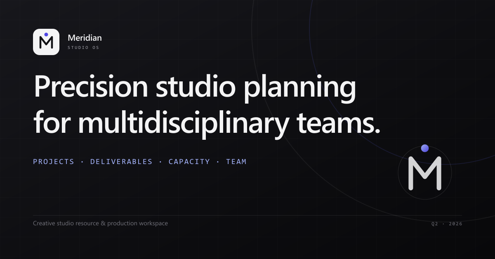

# Meridian Studio OS



A full-stack creative-studio resource and production workspace built with Next.js, PostgreSQL, Drizzle ORM, and Tailwind CSS.

**Live deployment:** <https://meridian-studio-pi.vercel.app>

## What is included

- Overview dashboard with studio KPIs, capacity, and deliverables
- Projects, deliverables, resource schedule, and studio team views
- Authenticated CRUD for projects, tasks, bookings, and team members
- Optional project file uploads backed by S3-compatible object storage
- Dark/light theme, responsive layout, and one-click demo personas

## Brand assets

| Asset | File | Use |
| --- | --- | --- |
| Project avatar | `public/brand/meridian-avatar.png` | GitHub profile/org avatar, social profiles, app icon |
| Social banner | `public/brand/meridian-social.png` | GitHub repository social preview, Open Graph/Twitter |
| Browser icon | `src/app/icon.svg` | Favicon / browser tab |
| Favicon fallback | `src/app/favicon.ico` | Legacy `/favicon.ico` requests |
| Apple touch icon | `src/app/apple-icon.png` | iOS home-screen icon (180×180) |
| Social preview | `src/app/opengraph-image.png`, `src/app/twitter-image.png` | Link previews (1200×630) |
| PWA icons | `public/icons/icon-192.png`, `icon-512.png`, `icon-maskable-512.png` | Installable app manifest |

Editable SVG sources are in `public/brand/` and `src/app/icon.svg`.

To set the GitHub repository preview, open the repository on GitHub and go to **Settings → General → Social preview → Upload an image**, then choose `public/brand/meridian-social.png`. The square avatar can be used for the GitHub profile or organization photo.

## Local development

Requirements: Node.js 20+ and a PostgreSQL database.

1. Install dependencies:

   ```bash
   npm install
   ```

2. Create `.env.local` from `.env.example` and set `DATABASE_URL` to your PostgreSQL connection string.

3. Push the schema:

   ```bash
   npm run db:push
   ```

4. Start the development server:

   ```bash
   npm run dev
   ```

Open <http://localhost:3000>. The first request seeds the demo workspace if the database is empty.

### Demo accounts

All seeded accounts use the password `Meridian2026!`.

- `areeb@meridian.studio`
- `julian@meridian.studio`
- `sora@meridian.studio`

You can also use the one-click personas on the login screen.

## Using Neon

The app reads `DATABASE_URL` for normal queries. Drizzle migrations prefer `DATABASE_URL_UNPOOLED` when it is present, because schema changes should use a direct connection.

If the project is linked with the Neon CLI, pull the branch variables with:

```bash
neon env pull --file .env.local
```

Then apply the schema:

```bash
npm run db:push
```

## Deploying to Vercel

1. Import the repository at <https://vercel.com/new>, or deploy with the CLI:

   ```bash
   vercel login
   vercel link
   vercel env add DATABASE_URL production
   vercel --prod
   ```

2. Use the Neon **pooled** connection string for `DATABASE_URL` in Vercel.

3. Push the schema to that database once with the direct connection:

   ```bash
   DATABASE_URL_UNPOOLED="postgresql://..." npm run db:push
   ```

4. Redeploy if you added the environment variable after the first deployment.

## Connect a Git repository

This workspace currently has a local Git repository but **no remote configured**. The initial commit is on `master`.

1. Create an empty repository on GitHub (for example `meridian-studio-os`).
2. Add it as the remote and push:

   ```bash
   git remote add origin https://github.com/<your-account>/meridian-studio-os.git
   git push -u origin master
   ```

   To use `main` instead of `master`:

   ```bash
   git branch -M main
   git remote add origin https://github.com/<your-account>/meridian-studio-os.git
   git push -u origin main
   ```

3. In Vercel, open the `meridian-studio` project and go to **Settings → Git → Connect Git Repository**. Install the Vercel GitHub app if the repository is not listed, then select it.
4. Set the production branch to `master` or `main` to match what you pushed.

After the repository is connected, every push to the production branch deploys automatically. Pull requests get their own preview deployments. Until then, deploy manually with `vercel --prod`.

## Custom domain

You can attach a domain you already own, or buy one from a registrar such as Cloudflare Registrar, Namecheap, or Porkbun.

1. In Vercel, open the `meridian-studio` project and go to **Settings → Domains**.
2. Enter the domain, for example `meridian.studio`, and click **Add**.
3. Add both the apex domain (`example.com`) and `www.example.com`; choose one as the redirect target.
4. At your domain registrar, either:
   - Replace the nameservers with the Vercel nameservers shown in the dashboard (recommended, lets Vercel manage DNS), or
   - Keep your current DNS and add the exact records Vercel displays. Typically this is an `A` record for the apex and a `CNAME` for `www`; use the values shown in the dashboard rather than copying stale values from a guide.
5. Wait for DNS to propagate. Vercel issues the HTTPS certificate automatically once the domain resolves.
6. Set the public site URL in Vercel so canonical links and social previews use the new domain:

   ```text
   NEXT_PUBLIC_APP_URL=https://your-domain.com
   ```

   Add it under **Settings → Environment Variables** for Production, then redeploy.

No application code changes are needed. If you later move to another host, the same domain can be pointed at the new provider.

## Production notes

- The dashboard and read APIs require a signed-in session.
- The demo login endpoint and open registration are intentional for the demo workspace. For a private deployment, disable `/api/auth/demo`, restrict `/api/auth/register`, and replace the shared demo password.
- Uploaded files require the Neon Object Storage (or another S3-compatible) variables from `.env.example`.
- Never commit `.env.local`.
